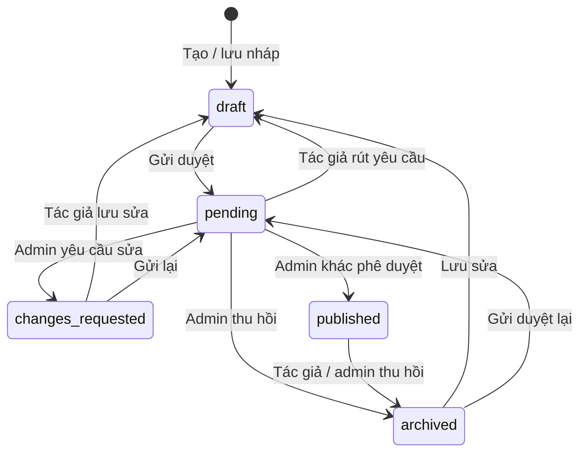

# Tài liệu cộng đồng và quy trình phê duyệt

Ngày cập nhật: 13/11/2026. Phạm vi đã triển khai: NestJS/PostgreSQL, App web và web Admin. Đây là nguồn contract cho phân hệ mới; các repo cần được cập nhật cùng nhau trước khi triển khai.

## Phân biệt nội dung

| Loại               | Mục đích                                                        | Luồng                                                                 |
| ------------------ | --------------------------------------------------------------- | --------------------------------------------------------------------- |
| Community document | Tài liệu đọc độc lập, có HTML tương tác, giấy phép và ghi công  | Tác giả gửi duyệt; admin khác phê duyệt trước khi vào thư viện        |
| Template           | Mẫu để dùng trong ghi chú, có revision và luồng chia sẻ hiện có | Luồng template được giữ riêng; chưa bắt buộc gửi duyệt trước xuất bản |
| Resource document  | Tài liệu riêng, được bảo vệ bởi resource gateway/workspace      | Không được tự động đưa vào cộng đồng                                  |

Thư viện cộng đồng hiện yêu cầu đăng nhập. Mọi tài khoản đăng nhập hợp lệ đều có thể tạo và gửi tài liệu của mình, không cần role `creator`. Chỉ `admin` được ra quyết định. Admin không được tự phê duyệt tài liệu của chính mình.

## Sử dụng

Trong App: **Kho Template → Mở thư viện mẫu → Cộng đồng → Tài liệu cộng đồng**. Có thể mở từ nút cùng tên trong panel Cộng đồng. Đăng nhập, chọn **Tạo tài liệu**, nhập metadata và HTML hoặc nạp tệp `.html`, rồi **Lưu bản nháp**. Tạo/lưu nháp chỉ gửi nội dung được chọn, không tự upload vault hoặc ghi chú khác.

Trong **Tài liệu của tôi**, mở tài liệu và chọn **Gửi duyệt**. Phải xác nhận quyền chia sẻ theo giấy phép đã chọn. Nội dung đang chờ không chỉnh sửa trực tiếp được; cần **Rút yêu cầu** trước. Khi được yêu cầu chỉnh sửa, đọc phản hồi, sửa/lưu và gửi lại.

Trong Admin tại `http://127.0.0.1:5183/#/documents`: hàng chờ mặc định là **Chờ duyệt**. Mở biểu tượng **Xem xét tài liệu**, đọc nội dung, giấy phép, ghi công và lịch sử. Nhập lý do rồi chọn **Phê duyệt và xuất bản**, **Yêu cầu chỉnh sửa** hoặc **Thu hồi**; mỗi quyết định cần xác nhận. Có thể chuyển tab để xem các trạng thái khác.

Sau khi duyệt, tài liệu vào **Thư viện đã duyệt** của App. Tác giả có thể thu hồi xuất bản; admin có thể thu hồi tài liệu đang chờ hoặc đã xuất bản với lý do. Thu hồi xong, API thư viện không còn trả tài liệu đó. Muốn sửa bản đã xuất bản, tác giả phải thu hồi, sửa và gửi duyệt lại.



## API

Tất cả endpoint dùng bearer session hiện có. Đường dẫn dưới đây không có tiền tố `/api`; Vite Admin chuyển tiếp `/api/*` sang backend.

| Phương thức | Đường dẫn                                   | Ý nghĩa                                                                         |
| ----------- | ------------------------------------------- | ------------------------------------------------------------------------------- |
| GET         | `/community/documents`                      | Danh sách đã xuất bản; không trả HTML, email tác giả hoặc phản hồi duyệt        |
| GET         | `/community/documents/:id`                  | Nội dung đã xuất bản, giấy phép/ghi công; không trả phản hồi hoặc lịch sử riêng |
| GET         | `/account/community-documents`              | Tài liệu của chính người gọi                                                    |
| GET         | `/account/community-documents/:id`          | Nội dung và tối đa 100 sự kiện gần nhất của chính tác giả                       |
| POST        | `/account/community-documents`              | Tạo nháp, trả 201                                                               |
| PATCH       | `/account/community-documents/:id`          | Lưu toàn bộ nháp với `version`                                                  |
| POST        | `/account/community-documents/:id/submit`   | `{ version, permissionConfirmed: true }`, trả 200                               |
| POST        | `/account/community-documents/:id/withdraw` | `{ version }`, trả 200                                                          |
| GET         | `/admin/community-documents`                | Danh sách quản trị, có email tác giả                                            |
| GET         | `/admin/community-documents/:id`            | Nội dung và lịch sử để duyệt                                                    |
| POST        | `/admin/community-documents/:id/decision`   | `{ version, action, reason }`, trả 200                                          |

Danh sách nhận `page` 1–10000, `size` 1–50, `search` tối đa 160 ký tự, `categoryId` và `status` (`all`, `draft`, `pending`, `changes_requested`, `published`, `archived`). Thư viện luôn chỉ lấy `published`, bất kể bộ lọc `status`. Response: `{ data, page, size, totalElements, totalPages }`; danh sách own/admin có thêm `pendingCount`.

Body tạo/lưu: `{ title, summary, categoryId, html, license, attribution }`; cập nhật thêm `version`. Giới hạn: tiêu đề 160 ký tự; tóm tắt 600; ghi công 160; HTML **512 KiB UTF-8**; giấy phép `MIT` hoặc `CC-BY-4.0`. Tối đa 50 tài liệu/tác giả, tính cả nháp và bản thu hồi; dùng lại bản hiện có khi đạt giới hạn. Chưa có xóa vĩnh viễn hoặc upload PDF/DOCX/asset nhị phân trong phân hệ này.

`action`: `approve`, `request_changes`, `archive`. Lý do bắt buộc, bỏ khoảng trắng đầu/cuối, dài 1–2000 ký tự. Mỗi lần lưu/chuyển trạng thái tăng `version`. Bản nháp của người khác trả 404 qua endpoint own; tài khoản thường gọi admin trả 403. Thiếu xác nhận chia sẻ trả 400; chạm giới hạn tạo trả 429; phiên bản/trạng thái không còn phù hợp trả 409.

Khi 409, giao diện giữ lý do/bản đang nhập và khóa gửi tiếp đến khi tải lại để đối chiếu; không tự ghi đè hoặc gửi lại mutation. App có thể refresh session cho request đọc; mutation gặp 401 không được tự phát lại sau refresh. Người dùng kiểm tra trạng thái rồi chủ động thử tiếp.

## Lưu trữ và vận hành

Chạy migration cộng thêm trước khi chạy backend mới:

```bash
# Trong erusentia-server, dùng cấu hình DB project local hiện có
pnpm project:migrate
pnpm build
pnpm test:admin
```

`sql/16_community_documents.sql` đã được đăng ký trong project migration journal. Nó tạo hai bảng `community_documents`, `community_document_events` và các index; không reset hoặc seed lại dữ liệu. Category đang được tài liệu tham chiếu không thể xóa; API Admin trả thêm `documentCount` để UI kiểm tra cùng số template.

Quyết định dùng khóa dòng và kiểm tra version trong transaction. Thay đổi trạng thái, sự kiện tài liệu và audit quản trị commit cùng nhau; audit lỗi làm rollback. Hai admin quyết định cùng version: chỉ một request thành công, request còn lại nhận 409. Audit dùng `DOCUMENT_APPROVED`, `DOCUMENT_CHANGES_REQUESTED`, `DOCUMENT_ARCHIVED`, target `community_document`. Đây là lịch sử thao tác và snapshot hiện tại, chưa phải kho revision HTML hay audit bất biến.

App dùng runtime preview cộng đồng hiện có; Admin dùng iframe opaque-origin `sandbox="allow-scripts"` và CSP. Nội dung được xem không có quyền truy cập session/storage của trang mẹ. Preview không lưu tương tác trở lại bản tài liệu. Việc phê duyệt là quyết định của người quản trị; chưa có bộ dò vi phạm tự động hoặc báo cáo tài liệu cộng đồng tích hợp với luồng report của template.

## Kiểm chứng

- Backend `pnpm test:admin`: 7/7 ca đạt, gồm kiểm tra nháp riêng, quyền, gửi/trả/sửa/gửi lại/duyệt/thu hồi, version cũ, tự duyệt, hai quyết định cạnh tranh và rollback khi audit lỗi. Wrapper tạo/xóa database local dùng một lần, không thao tác trên database dev/Neon.
- Admin: hai ca trình duyệt mới kiểm tra preview tương tác, xác nhận quyết định và giữ lý do khi xung đột; xem [biên bản Admin](../../erusentia-admin/docs/VERIFICATION.md).
- App `pnpm test:documents`: trình duyệt kiểm tra lưu nháp, xác nhận quyền chia sẻ, gửi duyệt và thư viện sau duyệt. Account dùng API fixture thật trong memory; endpoint tài liệu được mô phỏng có kiểm soát. Đây chưa phải một lần end-to-end Electron hoặc hosted.
- Transport: `node --test test/hub-documents.test.mjs test/hub-session.test.mjs` trong App, kiểm tra allowlist, sở hữu và phiên.

Đợt này chưa triển khai Keycloak/OIDC, role moderator/support, tự refresh phiên Admin, telemetry Redis/RabbitMQ hoặc DLQ redrive. Cấu hình free hosting và API hosted hiện có không được thay đổi hay deploy lại.
