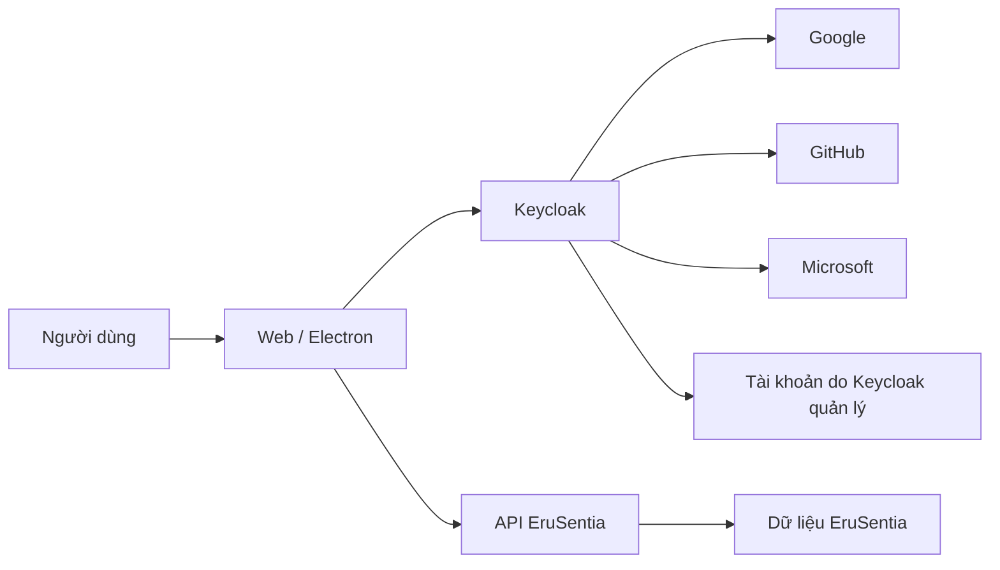

# Keycloak: kiến thức nền và cách dùng với EruSentia

Ngày nghiên cứu: **10/11/2026**. Trạng thái: **tài liệu nghiên cứu**, chưa cài Keycloak hoặc thay luồng đăng nhập đang chạy. Đọc tiếp [phương án tích hợp EruSentia](KEYCLOAK_INTEGRATION_PLAN.md) để xem thiết kế, migration và thứ tự triển khai.

Với điều kiện 0 đồng, không billing và có thể bỏ không dài hạn, Keycloak hosted hiện **chưa được chốt**. Đọc [ràng buộc free hosting và cold-start UX](FREE_HOSTING_AND_AUTH_CONSTRAINTS.md); không cần mua domain hoặc thuê VPS chỉ để tiếp tục dùng App hiện tại.

## 1. Keycloak giải quyết việc gì?

Keycloak là hệ thống quản lý danh tính và truy cập (IAM) mã nguồn mở, vận hành như một dịch vụ riêng. Với EruSentia, có thể xem đây là nơi tổ chức việc đăng nhập và quản trị tài khoản dùng chung cho web, desktop và các dịch vụ sau này.

Ví dụ: một người chọn Google trên trang đăng nhập Keycloak. Sau khi Google xác thực, Keycloak cấp thông tin đăng nhập cho EruSentia. API EruSentia làm việc với danh tính của Keycloak; việc thêm GitHub hoặc Microsoft được xử lý tại lớp broker. Keycloak có sẵn các connector này. [Identity brokering](https://www.keycloak.org/docs/latest/server_admin/index.html#_identity_broker).



Đăng nhập liên quan đến mạng; ghi chú/vault local vẫn có thể dùng offline theo khả năng hiện tại của App. Việc dùng Keycloak không làm ghi chú tự đồng bộ lên server.

## 2. OAuth 2.0, OpenID Connect và SSO

| Khái niệm | Hiểu trong dự án này |
|---|---|
| OAuth 2.0 | Cách cấp quyền truy cập một dịch vụ bằng token |
| OpenID Connect (OIDC) | Lớp danh tính trên OAuth 2.0 để ứng dụng biết người đăng nhập là ai |
| Authentication | Xác minh danh tính người dùng |
| Authorization | Quyết định người đó được thực hiện hành động nào |
| SSO | Dùng phiên đăng nhập ở nhà cung cấp danh tính để vào nhiều ứng dụng |
| Identity brokering | Keycloak kết nối tới nhà cung cấp đăng nhập bên ngoài |
| User federation | Kết nối kho người dùng như LDAP/Active Directory; khác việc thêm nút Microsoft |

Trong yêu cầu “đăng nhập OAuth”, phần EruSentia ↔ Keycloak nên dùng OIDC. Phía Google hỗ trợ OIDC; connector GitHub xử lý luồng OAuth và đọc hồ sơ của GitHub. Không cần giả định ba nhà cung cấp đều phát hành cùng một kiểu token. [Google OIDC](https://developers.google.com/identity/openid-connect/openid-connect), [GitHub OAuth](https://docs.github.com/en/apps/oauth-apps/building-oauth-apps/authorizing-oauth-apps).

## 3. Những thành phần cần biết khi mở Admin Console

| Thành phần | Ví dụ đề xuất cho EruSentia |
|---|---|
| Realm | `erusentia-dev`, `erusentia-staging`, `erusentia` |
| Client | `erusentia-web-bff`, `erusentia-desktop`, `erusentia-api` |
| Identity Provider | `google`, `github`, `microsoft` |
| User | Tài khoản trung tâm, có thể liên kết nhiều phương thức đăng nhập |
| Client role | `user`, `creator`, `admin` thuộc client API |
| Group | Gom người dùng để quản trị và gán role theo nhóm |
| Client scope / mapper | Chọn claim, role và audience xuất hiện trong token |
| Session | Phiên người dùng ở Keycloak và các ứng dụng liên quan |
| Service account | Danh tính máy dùng cho tác vụ server, không phải tài khoản người dùng |

Realm phân tách danh tính và cấu hình. `master` dành cho quản trị Keycloak; tạo realm riêng cho App. Một workspace/team trong EruSentia không mặc nhiên cần một realm riêng: dữ liệu thành viên của team có thể do backend quản lý. [Docker quickstart](https://www.keycloak.org/getting-started/getting-started-docker).

Client public là ứng dụng không thể bảo vệ client secret, ví dụ Electron hoặc SPA. Client confidential là backend có thể giữ secret hoặc khóa riêng, ví dụ BFF. Không nhúng secret của client confidential vào `VITE_*`, preload hoặc bộ cài.

## 4. Token nào dùng để làm gì?

| Thành phần | Vai trò trong thiết kế |
|---|---|
| Authorization code | Mã dùng một lần để đổi lấy token sau callback |
| Access token | BFF hoặc Electron gửi tới API |
| ID token | Client kiểm tra kết quả đăng nhập; không dùng thay access token gọi API |
| Refresh token | Xin access token mới; bên giữ token phải bảo vệ nó |
| JWKS | Bộ khóa công khai để API kiểm tra chữ ký token |
| Issuer (`iss`) | Realm đã phát hành token |
| Subject (`sub`) | Định danh người dùng trong issuer đó |
| Audience (`aud`) | Dịch vụ mà token được cấp để truy cập |

Các endpoint OIDC được công bố qua discovery của realm. API cần cấu hình rõ issuer và audience được chấp nhận. Việc đọc payload JWT hoặc thấy `role=admin` chưa chứng minh token hợp lệ. [Các endpoint OIDC của Keycloak](https://www.keycloak.org/securing-apps/oidc-layers).

Ví dụ discovery cho lab được đề xuất:

```text
http://127.0.0.1:8081/realms/erusentia-dev/.well-known/openid-configuration
```

HTTP ở đây chỉ phục vụ lab loopback. Môi trường triển khai thực tế cần HTTPS.

## 5. Vì sao chọn Authorization Code + PKCE?

Thiết kế dùng Authorization Code và PKCE `S256`, kèm kiểm tra `state` và OIDC `nonce`. Không xây luồng social login bằng cách gửi email/mật khẩu của người dùng tới token endpoint. Không bật Implicit hoặc Direct Access Grants cho các client App đề xuất. Đây là lựa chọn phù hợp hướng dẫn OAuth hiện hành. [OAuth Security BCP — RFC 9700](https://www.rfc-editor.org/rfc/rfc9700.html).

PKCE ràng buộc việc đổi code với bên đã bắt đầu đăng nhập. `state` gắn callback với lượt đăng nhập đang chờ; `nonce` được đối chiếu khi xác thực ID token. Mỗi lượt đăng nhập cần giá trị ngẫu nhiên riêng, hết hạn và chỉ dùng một lần.

Với Electron, mở trình duyệt hệ thống để người dùng đăng nhập; main process nhận callback và giữ token. [OAuth cho native app — RFC 8252](https://www.rfc-editor.org/rfc/rfc8252.html).

Với web, đề xuất BFF giữ token phía server; browser nhận cookie phiên HttpOnly. BFF vẫn cần bảo vệ CSRF và XSS trong ứng dụng vẫn có thể thực hiện hành động dưới phiên người dùng. [OAuth cho browser — RFC 10017](https://www.rfc-editor.org/rfc/rfc10017.html).

## 6. Phân chia trách nhiệm với EruSentia

| Keycloak quản lý | EruSentia quản lý |
|---|---|
| Đăng nhập, liên kết Google/GitHub/Microsoft | UUID nội bộ và ánh xạ tài khoản |
| Credential của tài khoản Keycloak, MFA, chính sách đăng nhập | Hồ sơ sản phẩm, ghi chú/vault, template, lịch sử |
| Gán client role và phiên SSO | Quyền sở hữu, quota, moderation, thành viên workspace |
| Luồng khôi phục credential do Keycloak sở hữu | Trạng thái khóa truy cập sản phẩm, audit nghiệp vụ |

Nếu người dùng chỉ đăng nhập qua Google, khôi phục mật khẩu Google diễn ra ở Google. Không tạo thêm mật khẩu EruSentia cho tài khoản social một cách ngầm định.

Keycloak có Authorization Services cho policy/resource/scope phức tạp. Đề xuất giai đoạn đầu chỉ dùng client role; backend tiếp tục kiểm tra quyền sở hữu từng template. Việc đưa toàn bộ ACL của từng ghi chú vào Keycloak tạo thêm công việc đồng bộ không cần thiết ở quy mô hiện tại. [Authorization Services](https://www.keycloak.org/docs/latest/authorization_services/index.html).

## 7. Liên kết nhiều cách đăng nhập

Mục tiêu sản phẩm là một tài khoản EruSentia có thể dùng Google, GitHub và Microsoft. Tuy nhiên, email giống nhau không đủ làm bằng chứng để ghép tài khoản tự động.

Đề xuất: người dùng xác thực tài khoản hiện có rồi chủ động thêm phương thức đăng nhập; với tài khoản EruSentia cũ, phải có bước chứng minh quyền kiểm soát trước khi ánh xạ sang Keycloak. Thao tác gỡ liên kết phải bảo đảm còn một phương thức đăng nhập dùng được. Đọc quy trình cụ thể trong [kế hoạch migration](KEYCLOAK_INTEGRATION_PLAN.md#7-tài-khoản-cũ-và-liên-kết-danh-tính).

## 8. Lab để làm quen Admin Console

Đây là hướng dẫn tùy chọn, **chưa được chạy trong lượt nghiên cứu này**. Quickstart chính thức được tra cứu đang minh họa image `26.8.2`; đó là mốc tham khảo, không phải cam kết phiên bản phù hợp production. Khi triển khai cần chốt patch version, kiểm tra advisory và ghim image/digest. [Quickstart chính thức](https://www.keycloak.org/getting-started/getting-started-docker).

Từ thư mục `EruSentia`, chuẩn bị file `.local/keycloak-lab.env` riêng, quyền 600:

```dotenv
KC_BOOTSTRAP_ADMIN_USERNAME=labadmin
KC_BOOTSTRAP_ADMIN_PASSWORD=<mat-khau-ngau-nhien-chi-cho-lab>
```

Thay placeholder bằng mật khẩu riêng rồi chạy thủ công:

```bash
docker run --rm --name erusentia-keycloak-lab \
  -p 127.0.0.1:8081:8080 \
  --env-file .local/keycloak-lab.env \
  quay.io/keycloak/keycloak:26.8.2 \
  start-dev --hostname=http://127.0.0.1:8081
```

Mở `http://127.0.0.1:8081/admin/`, đăng nhập tài khoản lab, tạo realm `erusentia-dev`, rồi thử tạo user, client và role. Chạy lab không đồng nghĩa App đã đăng nhập được bằng Keycloak.

Lệnh dùng database phát triển mặc định trong container, không mount volume; dừng/xóa container sẽ mất dữ liệu lab. PoC tích hợp cần PostgreSQL riêng và volume theo tài liệu kế hoạch. `start-dev` có cấu hình phục vụ phát triển và không dùng cho production. [Chạy Keycloak bằng container](https://www.keycloak.org/server/containers).

### Bài thực hành quản lý một creator

Sau khi tạo realm lab, thử theo thứ tự:

1. Tạo client `erusentia-api`, vào phần Roles và tạo `user`, `creator`, `admin`.
2. Tạo user test. Trong Role mapping, chọn client role `user` và `creator` của `erusentia-api` để gán cho tài khoản này.
3. Chỉ cấp `user` cho người đăng ký mới theo cấu hình mặc định đã chọn; quyền creator/admin phải qua thao tác quản trị.
4. Khi đã có client web/desktop PoC, đăng nhập lại để nhận token mới và kiểm tra client role trong token/API.
5. Thử thu hồi role và logout session; đo lúc API thực sự từ chối request. Không xem thao tác đổi trên Console là bằng chứng API đã cập nhật ngay.

Tên/vị trí mục trên Console có thể thay đổi theo phiên bản. Role `admin` vừa tạo là quyền của sản phẩm; quản trị Keycloak cần tài khoản/quyền quản trị riêng. Gán app-admin không đồng nghĩa cấp quyền quản trị realm.

## 9. Chi phí và vận hành

Lợi ích mong đợi là giảm việc tự xây login, MFA và liên kết provider khi có thêm ứng dụng. Đổi lại, nhóm phát triển chịu trách nhiệm uptime, cập nhật Keycloak, PostgreSQL, SMTP, secret rotation, backup và xử lý lỗi đăng nhập. Tự host vẫn có chi phí máy chủ và công vận hành.

Với EruSentia, nên thử local trước, sau đó staging độc lập, rồi mới quyết định máy chủ production dựa trên tải thực tế. Không lấy cấu hình lab hoặc một mức RAM ước lượng làm sizing cam kết. Dùng hướng dẫn [production](https://www.keycloak.org/server/configuration-production) và đo tải ở PoC.

Realm JSON dùng để mô tả cấu hình, không thay thế backup PostgreSQL. Export có giới hạn và không chứa đầy đủ trạng thái vận hành như session/event. Cần thử khôi phục database, khóa và secret theo cùng mốc backup. [Giới hạn import/export](https://www.keycloak.org/server/importExport).

## 10. Khi có lỗi, kiểm tra từ đâu?

| Triệu chứng | Kiểm tra trước |
|---|---|
| Provider báo redirect URI không hợp lệ | Callback **về Keycloak** đã đăng ký ở provider |
| Keycloak báo redirect không hợp lệ | Callback **về web/Electron** đã đăng ký ở client |
| Đăng nhập thành công nhưng API trả 401 | Issuer, audience, chữ ký, thời hạn, ánh xạ user và trạng thái phiên |
| Vào được tài khoản nhưng không có quyền admin | Client role của API, mapper và chính sách cập nhật quyền |
| Browser được, API Docker không lấy được JWKS | `127.0.0.1` trong container, hostname public và đường mạng nội bộ |
| Logout rồi token cũ vẫn gọi được API | Cách API kiểm tra revocation; xác minh JWT cục bộ chưa đủ |
| GitHub/Microsoft không có email dùng được | Scope/claim, privacy và bước bổ sung email đã xác minh |

Thiết kế hostname phải nhất quán; không đổi issuer thành địa chỉ Docker chỉ để né lỗi mạng. [Hostname và backchannel](https://www.keycloak.org/server/hostname).

## 11. Đọc và triển khai tiếp

1. [Kế hoạch tích hợp EruSentia](KEYCLOAK_INTEGRATION_PLAN.md): quyết định đề xuất và backlog có tiêu chí nghiệm thu.
2. [Keycloak Server Administration Guide](https://www.keycloak.org/docs/latest/server_admin/index.html): thao tác console và các khả năng quản trị.
3. [Keycloak JavaScript adapter](https://www.keycloak.org/securing-apps/javascript-adapter): tham khảo nếu chọn phương án SPA trực tiếp; adapter này có các giới hạn liên quan cookie và silent SSO của browser.

Các cấu hình cụ thể trong bộ tài liệu là **đề xuất cho EruSentia**, không phải tính năng đã có trong code hoặc kết quả nghiệm thu social login.
