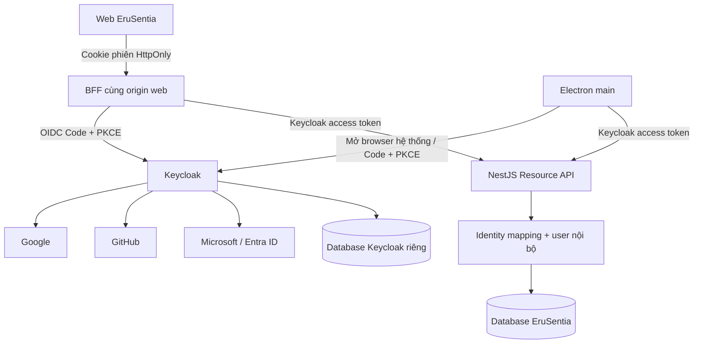

# Đề xuất tích hợp Keycloak cho EruSentia

Ngày nghiên cứu: **10/11/2026**. Trạng thái: **Proposed — chưa triển khai**. Tài liệu này dựa trên source của hai checkout hiện tại và tài liệu chính thức được liên kết tại từng phần. Phần giải thích kiến thức nằm ở [KEYCLOAK_GUIDE.md](KEYCLOAK_GUIDE.md).

**Cập nhật ràng buộc:** chủ dự án yêu cầu 0 đồng, không cấu hình billing và ít bảo trì. Vì vậy chưa triển khai Keycloak hosted theo kiến trúc dưới đây; chỉ giữ làm mục tiêu dài hạn/PoC local. Xem [phương án free và UX khi dịch vụ ngủ](FREE_HOSTING_AND_AUTH_CONSTRAINTS.md) trước khi chọn hạ tầng hoặc thực hiện K0–K6.

## 1. Quyết định đề xuất

Dùng **Keycloak làm OIDC provider/broker chung**, kết nối Google, GitHub và Microsoft. API xác thực access token do realm Keycloak đã cấu hình phát hành. Web dùng **BFF**, Electron dùng **public client + trình duyệt hệ thống + PKCE**. Giữ UUID tài khoản EruSentia, dữ liệu và quyền sở hữu hiện tại.

Phương án này phù hợp mục tiêu quản trị danh tính tập trung, nhưng cần thêm công việc về phiên, triển khai web và migration. Đợt đầu nên là PoC local độc lập, dùng tài khoản test; chưa thay đăng nhập hiện có hoặc dữ liệu hosted.

| Phương án | Điểm thuận lợi | Chi phí / giới hạn | Đánh giá cho dự án |
|---|---|---|---|
| Tích hợp ba provider trực tiếp vào NestJS | Ít dịch vụ mới | Tự quản lý linking, MFA, SSO, vòng đời danh tính | Không đáp ứng tốt mục tiêu quản trị qua Keycloak |
| Keycloak + SPA trực tiếp + Electron | Gần transport Bearer hiện tại; ít thay đổi hosting | Token có mặt trong JavaScript web; xử lý refresh và callback ở browser | Phương án giảm phạm vi nếu chấp nhận rõ trade-off |
| Keycloak + BFF web + Electron public client | Token web giữ trên server; phân chia rõ hai nền tảng | Thêm cookie/CSRF, session store và proxy cùng origin | **Đề xuất làm đích triển khai** |
| Keycloak đăng nhập rồi EruSentia tự cấp JWT/refresh riêng | Dễ giữ một phần contract cũ | Hai vòng đời session, khóa user và revoke phải đồng bộ | Chỉ cân nhắc cầu nối có thời hạn; không làm kiến trúc mặc định |

So sánh BFF với SPA dựa trên [RFC 10017](https://www.rfc-editor.org/rfc/rfc10017.html). Đây là lựa chọn kiến trúc cho EruSentia; mức độ sửa code được suy ra từ source hiện tại, chưa phải benchmark triển khai.

## 2. Source hiện tại và phần cần thay

| Vị trí | Hiện tại | Thay đổi dự kiến |
|---|---|---|
| `src/auth/auth.module.ts` | JWT HS256, issuer `erusentia-server`, audience `erusentia-api` | Thêm verifier Keycloak tách biệt theo auth mode |
| `src/auth/auth.service.ts` | Login/password, phát JWT; refresh token ngẫu nhiên, hash trong DB | Tách legacy khỏi OIDC identity/session adapter |
| `src/auth/auth.guards.ts` | Bearer → user nội bộ + family session | OIDC principal → ánh xạ user → trạng thái tài khoản/quyền |
| `src/auth/auth-store.ts` | Một role `user/creator/admin`; mật khẩu bắt buộc trong model | Model hỗ trợ tài khoản external và quyền được chuẩn hóa |
| `sql/01_schema.sql`, `sql/05_auth_sessions.sql` | UUID, email/password, FK của dữ liệu; refresh family | Migration bổ sung identity và trạng thái OIDC, giữ FK |
| `src/infrastructure/database/project-migrations.ts` | Journal/checksum và danh sách migration tường minh | Đăng ký migration mới, không sửa checksum file cũ |
| App: `shared/hub-session.mjs` | Browser giữ token trong memory; fetch `credentials: 'omit'`; redirect HTTP bị từ chối | Web transport cookie/BFF riêng; login bằng navigation |
| App: `src/store/hub/index.ts` | UI gọi login/register bằng email/password | Nút OIDC/provider, callback/resume và account capabilities |
| App: `electron/hub-bridge.mjs`, `electron/main.js`, `electron/preload.cjs` | Main process giữ session; renderer chỉ nhận snapshot qua IPC | Login qua browser hệ thống, callback về main và IPC đã kiểm tra |
| `render.yaml`, `docker/compose.project.yml`, App `docker-compose.yml` | API và web tách origin; cache local bật nhưng hosted config tắt | Keycloak/DB riêng, routing BFF và session store phù hợp hosted |

Hai khả năng đang có phải được bảo toàn khi thay auth: API chặn user inactive/deleted và kiểm tra ownership theo UUID nội bộ; editor/vault không bắt buộc online. Bản desktop đã phát hành có contract legacy, nên cần thời gian tương thích và version hỗ trợ rõ ràng.

## 3. Kiến trúc đích



BFF là một vai trò kiến trúc; có thể ở cùng codebase NestJS hoặc một service riêng. Khi triển khai chung vẫn cần phân biệt cookie endpoint và resource API, có chính sách CSRF và route proxy tường minh. Chọn thư viện OIDC/JWT còn được duy trì sau PoC; không tự viết bộ xác thực JWT, PKCE hoặc xác minh logout token.

### Realm và client

| Đối tượng | Cấu hình đề xuất |
|---|---|
| Realm local | `erusentia-dev`; staging/production tách riêng |
| `erusentia-web-bff` | Confidential; Standard Flow bật; PKCE `S256`; secret/khóa chỉ ở backend |
| `erusentia-desktop` | Public; Standard Flow bật; PKCE `S256`; không client secret |
| `erusentia-api` | Định danh resource/audience và nơi chứa client roles; không cần luồng login tương tác |
| Service account quản trị | Tạo riêng nếu cần; chỉ cấp quyền đã chứng minh cần thiết, không đưa `realm-admin` vào App |

Implicit, Direct Access Grants và service account của hai client người dùng tắt. Scope khởi đầu `openid profile email`; chưa yêu cầu `offline_access`. Audience mapper cho hai client đăng nhập phải đưa `erusentia-api` vào access token. Thiết lập Web Origins theo từng client và exact origin cần dùng; CORS không thay thế đăng ký redirect URI. [Client, mapper và audience](https://www.keycloak.org/docs/latest/server_admin/index.html).

## 4. Web: BFF và thay đổi hosting

1. Browser điều hướng tới `/bff/auth/login`, có thể chọn provider từ allowlist.
2. BFF tạo transaction có state/nonce/PKCE, lưu server-side, chuyển sang Keycloak.
3. Provider trả về broker callback của Keycloak; Keycloak trả code về callback BFF.
4. BFF kiểm tra transaction, đổi code, xác thực OIDC, ánh xạ tài khoản.
5. Browser nhận cookie ID phiên, gọi `/bff/session`; không nhận access/refresh token.
6. `/bff/api/*` lấy access token server-side để gọi resource API. Refresh được khóa theo phiên để tránh nhiều request cùng xoay token.

Endpoint và cookie ở đây là contract **dự kiến**:

| Endpoint | Mục đích |
|---|---|
| `GET /bff/auth/login?provider=google` | Bắt đầu login, provider chỉ nhận alias cho phép |
| `GET /bff/auth/callback` | Xử lý code/state, xóa transaction đã dùng |
| `GET /bff/session` | Trả user nội bộ/capabilities; không trả token |
| `POST /bff/logout` | Thu hồi phiên BFF và thực hiện chính sách logout đã chọn |
| `/bff/api/<route-cho-phep>` | Proxy hữu hạn cho nghiệp vụ; không nhận upstream URL tùy ý |
| `POST /auth/oidc/backchannel-logout` | Callback server-to-server, kiểm tra logout token độc lập với user Bearer guard |

Cookie production đề xuất: `__Host-eru_session`, `Secure`, `HttpOnly`, `SameSite=Lax`, `Path=/`, không `Domain`. Dùng callback top-level GET tương thích chính sách cookie này. Mọi thao tác đổi trạng thái dùng CSRF token cùng kiểm tra Origin/Fetch Metadata phù hợp; không dựa riêng vào SameSite. Local HTTP có cookie development riêng, không áp dụng tên `__Host-` thiếu Secure.

Source hiện cấu hình web ở Vercel và API ở Render, thuộc hai site khác nhau. BFF không thể được đưa lên origin API rồi mặc định coi cookie xuyên site sẽ hoạt động. Đề xuất expose `/bff/*` **dưới origin web** bằng reverse proxy/rewrite, hoặc chuyển web+BFF về cùng origin có domain do dự án kiểm soát. Cần thử forwarding `Cookie`/`Set-Cookie`, callback public URL, cache bypass và CSRF thực tế trên staging.

BFF session store đề xuất dùng PostgreSQL và TTL cleanup; token server-side được mã hóa bằng khóa ngoài DB. Redis cache hiện tại dùng `allkeys-lru`, còn hosted config tắt Redis: không mặc nhiên dùng nó làm kho phiên bền vững. Nếu chọn Redis session riêng phải có cấu hình và chính sách mất dữ liệu riêng.

Nếu chưa làm được routing cùng origin, có thể chọn SPA trực tiếp như phương án giảm phạm vi: public client, PKCE, token memory, không localStorage/IndexedDB; ghi rõ thay đổi quyết định. `keycloak-js` là lựa chọn để đánh giá, nhưng silent SSO/logout detection còn phụ thuộc chính sách cookie browser. [JavaScript adapter](https://www.keycloak.org/securing-apps/javascript-adapter).

## 5. Electron: public client và callback local

Main process tạo transaction PKCE/state/nonce, mở URL xác thực Keycloak bằng trình duyệt hệ thống, nhận callback và đổi code. Renderer chỉ nhận trạng thái đăng nhập/user qua IPC. Không nhúng trang Google vào BrowserWindow, không chuyển token qua query string hoặc IPC snapshot. Hướng này dựa trên [RFC 8252](https://www.rfc-editor.org/rfc/rfc8252.html).

Ưu tiên callback loopback: listener chỉ bind `127.0.0.1`, đường dẫn riêng, thời gian chờ ngắn, transaction một lần, đóng listener sau thành công/hủy. Cổng động là hướng theo RFC; PoC phải kiểm tra Keycloak phiên bản ghim hỗ trợ matching cổng loopback như thế nào. Nếu chưa hỗ trợ đúng, dùng cổng cố định đăng ký exact, báo lỗi khi cổng bị chiếm; không giải quyết bằng wildcard toàn bộ redirect URL.

Custom URI scheme có thể đánh giá sau nếu cần, kèm đăng ký handler, kiểm tra callback và chống scheme hijacking bằng PKCE. Không tự mở rộng handler deep link thành nơi thực thi URL tùy ý.

Giai đoạn đầu giữ token trong main-process memory như hiện tại. “Ghi nhớ đăng nhập” là hạng mục riêng, cần đánh giá OS credential storage. Không cho rằng dữ liệu mã hóa trên Linux luôn được bảo vệ bằng keyring nếu backend secret storage không khả dụng.

## 6. Ba provider và hai lớp callback

Chọn Identity Provider ở realm, sao chép **Redirect URI mà console Keycloak hiển thị**, đăng ký URI đó tại provider, rồi điền client ID/secret vào Keycloak. BFF/Electron chỉ biết Keycloak; secret Google/GitHub/Microsoft thuộc cấu hình broker.

Ví dụ minh họa, thay domain thật và realm trước khi đăng ký:

```text
Provider → Keycloak:
https://auth.example.com/realms/erusentia/broker/google/endpoint
https://auth.example.com/realms/erusentia/broker/github/endpoint
https://auth.example.com/realms/erusentia/broker/microsoft/endpoint

Keycloak → web BFF:
https://app.example.com/bff/auth/callback

Keycloak → Electron (ví dụ cổng cố định cho PoC):
http://127.0.0.1:49185/oidc/callback
```

URI provider và URI client là hai lớp riêng biệt. Local không tráo lẫn `localhost` và `127.0.0.1`; development/staging/production dùng credential riêng.

### Google

Tạo project và OAuth client loại Web application, cấu hình consent/audience/test users theo trạng thái ứng dụng và đăng ký callback broker. Bắt đầu bằng scope danh tính; không xin Drive/Gmail chỉ để login. Dùng connector Google của Keycloak. Kiểm tra chính sách email verification trước khi bật Trust Email. [Google OIDC](https://developers.google.com/identity/openid-connect/openid-connect).

### GitHub

Với connector GitHub của Keycloak, PoC đăng ký GitHub OAuth App tương ứng. Đây là đăng nhập; chức năng đọc/ghi repo GitHub của EruSentia vẫn là phạm vi tích hợp khác, không xin scope `repo` trong luồng login. Xác nhận scope tối thiểu của connector, gồm `user:email` nếu cần email private, và kiểm thử trường hợp người dùng ẩn email.

Email có thể thiếu; không dùng GitHub username làm email. Nếu cần chọn email, phải kiểm tra thông tin `primary`/`verified` từ nguồn đáng tin hoặc yêu cầu người dùng bổ sung/xác minh. [Tạo OAuth App](https://docs.github.com/en/apps/oauth-apps/building-oauth-apps/creating-an-oauth-app), [GitHub email API](https://docs.github.com/en/rest/users/emails).

### Microsoft

Chốt nhóm người dùng trước khi cấu hình App registration:

| Mục tiêu | Phạm vi tài khoản |
|---|---|
| Chỉ nhân viên một công ty | Single tenant, tenant ID cụ thể |
| Nhiều công ty/trường học | Multitenant work/school |
| Người dùng công cộng | Work/school và personal Microsoft account |

Giả định nghiên cứu cho EruSentia công cộng là hỗ trợ cả personal và work/school, nhưng đây là quyết định cần chốt trước PoC. Connector Microsoft có sẵn là bước đánh giá đầu tiên; nếu cần tenant policy/claim cụ thể, đánh giá generic OIDC với Entra v2 discovery. Không coi `common` là biện pháp giới hạn tenant; nếu sản phẩm chỉ nhận tenant cho phép, phải kiểm tra đúng issuer/tenant và allowlist.

Đăng ký callback phía Microsoft là nền tảng **Web**, vì bên nhận code từ Microsoft là Keycloak. Theo dõi hạn client secret. `email`/`preferred_username` không phải khóa nhận dạng bền vững và có thể thiếu/thay đổi. [Loại tài khoản](https://learn.microsoft.com/en-us/entra/identity-platform/single-and-multi-tenant-apps), [OIDC Entra](https://learn.microsoft.com/en-us/entra/identity-platform/v2-protocols-oidc), [Claims](https://learn.microsoft.com/en-us/entra/identity-platform/id-token-claims-reference).

## 7. Tài khoản cũ và liên kết danh tính

**Giữ `users.id` của EruSentia.** `templates.author_id`, revision/audit và dữ liệu khác vẫn tham chiếu UUID đó. Không đổi thành Keycloak `sub`, không tìm user chỉ theo email của token, không tự nâng role theo email/domain.

Mô hình schema dự kiến, chưa phải migration chạy được:

```text
auth_external_identities
  id                UUID
  user_id           UUID -> users.id
  issuer            TEXT
  subject           TEXT
  linked_at         TIMESTAMPTZ
  UNIQUE (issuer, subject)
  UNIQUE (user_id, issuer)  # nếu mỗi user chỉ có một tài khoản trong mỗi realm
```

API ánh xạ `(issuer Keycloak, sub Keycloak)` sang user nội bộ. Danh tính Google/GitHub/Microsoft liên kết vào cùng Keycloak user được broker quản lý; không cần App tự suy ra danh tính từ token upstream. Chuyển realm/hostname làm thay đổi issuer cần kế hoạch mapping riêng.

Các tình huống:

| Tình huống | Cách xử lý đề xuất |
|---|---|
| Người dùng mới, email hợp lệ không trùng | Provision user nội bộ + identity trong transaction, role khởi đầu `user` |
| Email đã có tài khoản legacy | Chuyển sang bước liên kết có xác thực tài khoản cũ; không ghép ngầm |
| Đã đăng nhập legacy, muốn thêm social | Yêu cầu xác thực gần đây; transaction linking gắn với user hiện tại; xác thực OIDC lại và kiểm tra collision |
| Đã có Keycloak user, muốn thêm provider | Dùng Account Console/flow linking của Keycloak có xác thực; API mapping giữ nguyên |
| Provider không cung cấp email hợp lệ | Trạng thái onboarding chờ email và xác minh; chưa tạo account dùng email giả |
| Cùng provider identity đã liên kết user khác | Từ chối; phục hồi tài khoản theo quy trình riêng, không đổi ownership |

Giữ First Broker Login yêu cầu chứng minh quyền sở hữu khi phát hiện tài khoản có sẵn; không cấu hình auto-link chỉ dựa email. Trust Email áp dụng theo từng provider sau kiểm thử claim; nó không thay thế proof để ghép với tài khoản legacy.

`users.password_hash` hiện NOT NULL, model/password flow đều giả định có hash. Đề xuất migration mới cho phép tài khoản external không có local credential, kèm `auth_source`/capability rõ ràng. Sửa login legacy để external-only luôn bị từ chối; không tạo mật khẩu mặc định chung. Unique email cũ phải được xử lý cùng trạng thái onboarding và collision; không bỏ unique index để tránh xử lý linking.

Chưa chọn nhập hash Argon2 trực tiếp. Hệ thống đích có thể khác định dạng/metadata/tham số; cần thử một bản sao dữ liệu test. Mặc định ưu tiên social linking và đặt credential mới trong Keycloak cho người vẫn muốn dùng password. User Storage SPI chỉ đánh giá khi thật sự cần chuyển đổi mật khẩu trong suốt. [Keycloak SPI](https://www.keycloak.org/docs/latest/server_development/index.html).

## 8. Phân quyền và nguồn dữ liệu có thẩm quyền

Đích đề xuất: Keycloak quản lý **gán client role** của `erusentia-api`; API quản lý ownership, quota, moderation, workspace membership và trạng thái khóa sản phẩm. User không có role API hợp lệ không được tự mặc định thành creator/admin.

Trích claim minh họa; access token thật còn có claim thời hạn và thông tin phiên:

```json
{
  "iss": "https://auth.example.com/realms/erusentia",
  "sub": "<keycloak-user-subject>",
  "aud": ["erusentia-api"],
  "azp": "erusentia-web-bff",
  "resource_access": {
    "erusentia-api": { "roles": ["user", "creator"] }
  }
}
```

Role mapping giữ contract `UserIdentity.role` hiện tại trong giai đoạn chuyển đổi: chỉ đọc role đã cho phép thuộc đúng client API; khi có nhiều role chọn `admin > creator > user`. Không đọc `realm-management` để suy ra admin sản phẩm. Không suy ra quyền sở hữu từ role; creator tiếp tục theo quyền thực tế hiện có, không được quyền quản trị chỉ vì tên role.

`users.role` khi chuyển xong là projection phục vụ tương thích, không phải kênh gán quyền cạnh tranh. Mọi nơi đang đọc role phải được rà lại. Trong hybrid, mỗi user có nguồn auth/quyền tường minh; thay đổi role của user Keycloak phải qua Keycloak hoặc workflow quản trị đã thiết kế, không để hai phía tự ghi độc lập.

Nếu sau này có nhiều tổ chức: role `admin` hiện tại là quyền toàn sản phẩm. Quyền như chủ workspace, thành viên, người đọc cần scope theo workspace trong DB; không biến tất cả thành admin realm. Keycloak Organizations có thể được đánh giá cho B2B khi có yêu cầu cụ thể, không thay cho mô hình quyền dữ liệu của App.

## 9. API verifier và vòng đời phiên

### Xác thực token

Verifier OIDC phải kiểm tra chữ ký với JWKS tin cậy, allowlist thuật toán, exact issuer, audience `erusentia-api`, `exp`/`nbf` với clock skew nhỏ; kiểm tra client được phép theo chính sách `azp` phù hợp token thực tế. Từ chối ID token, token upstream của provider, token cho audience khác và token thiếu claim bắt buộc.

Không dùng trường `iss`, `jku` hoặc URL do token/caller cung cấp để tự chọn nơi tải khóa. Cấu hình issuer/JWKS được quản trị trước, có timeout/cache/rate limit khi `kid` lạ và kế hoạch xoay khóa. Sau xác thực vẫn kiểm tra user mapping và trạng thái inactive/deleted của EruSentia.

Hybrid không phải “JWT nào verify được thì cho vào”. Có hai verifier tách biệt: legacy HS256 và OIDC với cấu hình riêng. Token khai là OIDC mà verify thất bại không được fallback sang legacy; không dùng chung key/algorithm rules. Claim chưa xác thực chỉ được dùng chọn nhánh cố định từ allowlist, không dùng làm quyền.

### Logout, khóa user và đổi role

Hiện API kiểm tra DB refresh-family trên mỗi request nên session đã revoke bị chặn ngay. Xác thực chữ ký JWT Keycloak cục bộ **không tự giữ được tính chất đó**: token còn hạn có thể tiếp tục hợp lệ; role trong token cũng là snapshot. Không hứa “đổi role/logout ở console là mọi request dừng ngay”.

Thiết kế cần tách các tầng:

| Sự kiện | Hành vi cần thiết kế |
|---|---|
| Logout BFF hiện tại | Xóa phiên server/cookie; thực hiện revoke/end-session phù hợp, không chỉ xóa UI |
| Logout Electron | Xóa token main process và revoke/đóng phiên theo policy; local note vẫn còn |
| Backchannel logout từ Keycloak | Kiểm tra chữ ký, issuer/audience, events và chống replay; chặn phiên theo `(iss, sid)` |
| Khóa truy cập sản phẩm | `users.is_active/deleted_at` tiếp tục được API kiểm tra, không đợi refresh token |
| Logout mọi thiết bị | Bao phủ cả legacy family, BFF và session Keycloak; không chỉ một bảng hiện tại |
| Hạ role ở Keycloak | Token cũ có thể còn quyền cũ; critical endpoint cần policy cập nhật quyền riêng |

PoC phải xác nhận claim phiên `sid` và nội dung logout token trên bản Keycloak ghim, cùng cấu hình client phù hợp. Không thay `sid` bằng `jti`: một token và một phiên có vòng đời khác nhau. UI phân biệt đăng xuất App với đăng xuất SSO; không hứa đăng xuất Keycloak sẽ đóng luôn phiên Google/GitHub/Microsoft trong trình duyệt.

Mốc PoC đề xuất access token **5 phút** là lựa chọn của dự án, không phải mặc định Keycloak. Đo tác động của refresh và chấp nhận độ trễ trước khi dùng JWT-only cho request thông thường.

Đối với admin/quyền nhạy cảm, PoC phải thử introspection với confidential client và đọc quyền hiện hành bằng kênh server có quyền tối thiểu nếu cần; **introspection không mặc nhiên tính lại role trong JWT cũ**. Khi user bị khóa hoặc session đã revoke, cần kiểm chứng kết quả `active` trên phiên bản ghim. Không dùng cache kết quả dài hơn SLA thu hồi đã chốt. [Introspection và logout](https://www.keycloak.org/securing-apps/oidc-layers).

Workflow hạ quyền qua EruSentia có thể ghi deny overlay nội bộ trước rồi cập nhật Keycloak; overlay phải chặn cả legacy nếu cùng user. Thay đổi trực tiếp trong Admin Console cần có cơ chế quan sát/đồng bộ riêng hoặc chấp nhận rõ cửa sổ stale. Backchannel logout không phải thông báo tổng quát cho mọi thay đổi role. Không giả định đã có webhook tự động nếu chưa triển khai.

**Điều kiện trước production:** có kiểm thử đo revoke/demotion và quyết định SLA bằng số. Nếu yêu cầu chặn ngay mà PoC chỉ chứng minh JWT hết hạn sau 5 phút, phương án chưa đạt; phải bổ sung online checks/deny state và đường quản trị phù hợp.

## 10. Hạ tầng local và production

Local PoC thêm `keycloak` và `keycloak-postgres` riêng, database/user/volume độc lập. Dự kiến public `127.0.0.1:8081`; DB Keycloak không publish host port. Mailpit hiện tại có thể làm SMTP sink cho realm dev. Không cho Keycloak đọc/ghi bảng `users` của EruSentia bằng cùng credential DB.

Lab host dùng issuer `http://127.0.0.1:8081/realms/erusentia-dev`; trong container `127.0.0.1` là chính container. PoC phải giải quyết đường truy cập của API/BFF: hoặc hostname/gateway dùng được cả hai phía, hoặc backchannel/JWKS transport cấu hình tường minh tới dịch vụ nội bộ, vẫn validate issuer public chính xác. Không tắt kiểm tra issuer hoặc TLS để khắc phục routing. [Hostname](https://www.keycloak.org/server/hostname).

Production cần hostname/TLS, DB được backup, SMTP gửi thật, monitoring, bản vá và kế hoạch khôi phục. Chưa chọn nhà cung cấp hoặc dự toán giá trong nghiên cứu này. Config Render hiện có cho API không mặc nhiên đủ để vận hành Keycloak; cần hạ tầng riêng hoặc dịch vụ Keycloak được quản lý, đánh giá bằng tải và uptime thực tế.

Đường admin phải được giới hạn bởi ingress/VPN/allowlist phù hợp. `hostname-admin` riêng không tự chặn Admin API qua hostname public. Health/metrics management port không được publish công khai tùy tiện. Bật user/admin event audit và retention, không log code/token/secret. [Production](https://www.keycloak.org/server/configuration-production), [Reverse proxy](https://www.keycloak.org/server/reverseproxy).

Realm/client/role config giữ dạng export đã bỏ secret để review; không dùng import override như migration mỗi lần startup. Backup DB Keycloak, DB App, khóa mã hóa BFF và provider secret phải có quy trình phục hồi tương thích. [Import/export](https://www.keycloak.org/server/importExport).

## 11. Lộ trình triển khai và nghiệm thu

| Chặng | Công việc | Điều kiện hoàn thành |
|---|---|---|
| K0 — PoC IAM | Compose/profile Keycloak riêng, DB, realm/client/role, tài khoản test | Discovery/issuer đúng từ host và Docker; startup lại giữ dữ liệu; không đụng DB App cũ |
| K1 — Resource API | Verifier OIDC, migration identity, provision/onboarding, legacy mode riêng | Token sai issuer/audience/algorithm bị chặn; giữ UUID/ownership, inactive/deleted vẫn bị chặn |
| K2 — Web BFF + Google | Callback, session/cookie/CSRF, proxy, UI và routing | Login/cancel/refresh/logout thật trên Chrome và browser chặn cookie bên thứ ba; không lộ token web |
| K3 — GitHub + Microsoft | App registration, scopes, email edge cases, tenant policy | Cả ba provider đăng nhập thật; không tự ghép sai user; tenant ngoài phạm vi bị chặn |
| K4 — Desktop | Browser hệ thống, callback listener, PKCE, IPC, đóng/hủy | Gói Electron trên nền tảng hỗ trợ hoạt động; renderer không thấy token; callback replay bị chặn |
| K5 — Migration và vận hành | Linking tài khoản cũ, role/session UI, revoke/demotion, backup/restore | Đạt SLA; phục hồi được; legacy client được xử lý theo version hỗ trợ |
| K6 — Cutover | Pilot nhỏ, quan sát, chuyển auth chính, dọn legacy có kế hoạch | Có bằng chứng đầy đủ rồi mới tắt password/refresh flow cũ; không bỏ dữ liệu để rollback |

Test không cần provider thật: verifier/JWKS rotation, state/nonce/PKCE/replay, migration/collision, ownership/quota/moderation, csrf, refresh race, lỗi Keycloak, timeout và local offline. CI dùng realm/DB test riêng. Token fixtures không được thay thế toàn bộ kiểm thử protocol.

Test cần provider thật: Google/GitHub/Microsoft callback, consent bị từ chối, email thiếu/trùng, account linking có xác thực, personal/work-school/tenant scope và desktop system browser. Cần credential test riêng và tài khoản test do chủ dự án quản lý.

Đo thêm: Keycloak mất kết nối; JWKS đã cache/chưa cache; session store lỗi; refresh nhiều tab/thiết bị; logout mọi thiết bị; role demotion ở cả Eru UI và Keycloak Console; không auto-replay thao tác ghi khi login hoàn tất.

### Migration và rollback

Backup trước, chạy migration mới trên bản sao dữ liệu, kiểm tra số lượng user và ownership. Triển khai theo `legacy`, `hybrid`, `keycloak` (tên mode dự kiến). Rollback phải bảo toàn deny state và việc hạ quyền; không bật lại legacy password của user external-only hoặc user đã bị khóa để “cứu login”.

Chuyển email verification/reset cho danh tính Keycloak sang luồng của Keycloak/provider. Giao diện session hiện tại cần phân biệt các nguồn session và khả năng quản lý; không giả vờ bảng `auth_refresh_sessions` đang thể hiện mọi phiên SSO. Đăng ký qua OIDC phải phát welcome event đúng một lần sau khi provision user nội bộ thành công.

Không sửa migration đã áp dụng, không reset DB, không nhập demo password mặc định vào realm production. Chưa xóa bảng legacy/hash cho tới khi hoàn tất cửa sổ hỗ trợ client cũ và kiểm tra rollback.

## 12. Những quyết định cần chốt trước khi viết tính năng

1. Microsoft nhận personal + work/school hay chỉ tenant doanh nghiệp?
2. Chọn BFF và bố trí origin/domain như đề xuất, hay chấp nhận SPA trực tiếp ở chặng đầu?
3. Giữ đăng nhập mật khẩu bằng Keycloak bên cạnh social hay hướng tới social-first? Các bản desktop legacy được hỗ trợ bao lâu?
4. SLA logout/khóa/hạ quyền là tức thời, vài giây hay tối đa một access-token TTL? Ai được đổi role trực tiếp tại Console?
5. Ngân sách/uptime cho Keycloak, SMTP và domain; có yêu cầu doanh nghiệp/multi-tenant ngay không?

Giả định làm việc hiện tại: PoC local, giữ fallback legacy có kiểm soát, web BFF, Electron PKCE, thử Google trước rồi GitHub/Microsoft. Các giả định này chưa phải thay đổi đã được kích hoạt.

## 13. Phạm vi thực hiện của lượt nghiên cứu

Đã đọc auth/session/role/schema/transport của dự án, đối chiếu tài liệu chính thức và viết phương án này. Chưa thêm dependency, Compose service, realm, provider credential, migration hoặc code đăng nhập; chưa chạy social login thật. Nghiệm thu nội dung và liên kết tài liệu không thay thế các tiêu chí K0–K6.
