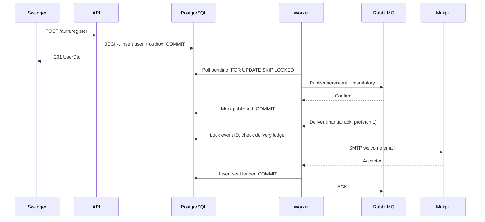

# Message Queue — welcome email cho EruSentia

## Phạm vi

NestJS/TypeORM/PostgreSQL tuần 3 được mở rộng bằng RabbitMQ và worker TypeScript.
App chưa tích hợp API. Use case: tài khoản đăng ký thành công nhận welcome email
qua Mailpit local. Không có email verification, không gọi dịch vụ gửi email ngoài.
API không đổi response/endpoint; Swagger vẫn 11 operation.

`QUEUE_ENABLED=false` mặc định giữ flow tuần 3. Khi bật phải dùng PostgreSQL và áp
`sql/06_message_queue.sql` sau auth. Không tự migrate; memory + queue bị từ chối.

## Flow và ranh giới transaction

Dispatcher/consumer ở cùng process CLI nhưng là hai vai trò độc lập, API là process
riêng. Poll mỗi giây, batch tối đa 10. FOR UPDATE SKIP LOCKED cho phép nhiều dispatcher
không giữ cùng row. Nếu publish thành công rồi DB commit lỗi, event được publish lại;
consumer phải idempotent. Không có distributed transaction DB/RabbitMQ/SMTP.

## Event và topology

`user.registered.v1`: id, type, schemaVersion=1, userId, occurredAt; messageId=id.
Không mang password, hash, email, JWT, refresh token hoặc nội dung App. Consumer đọc
email của tài khoản active/chưa soft-delete từ DB; account không hợp lệ ghi skipped.
Payload giới hạn 4096 byte, kiểm tra trường/UUID/type/version/timestamp/messageId và
đối chiếu payload gốc ở outbox; event lạ/malformed vào DLQ.

Namespace mặc định `erusentia`, có thể đặt QUEUE_NAMESPACE riêng cho test/demo:

| Tên | Loại / vai trò |
|---|---|
| erusentia.events | Topic exchange, routing key user.registered.v1 |
| erusentia.welcome | Durable quorum queue; competing consumers |
| erusentia.welcome.retry | Durable quorum queue, TTL 5000 ms, DLX về events |
| erusentia.dead | Direct dead-letter exchange cho broker delivery limit |
| erusentia.welcome.dead | Durable quorum queue giữ poison/exhausted messages |

Hiện triển khai một subscriber welcome; không gọi đây là demo fan-out hoàn chỉnh.
Nhiều consumer cùng queue chia việc, không phải mỗi consumer nhận một bản. Muốn
pub/sub thêm subscriber cần một queue/binding riêng trên exchange, không sửa queue
welcome thành một consumer broadcast.

## Confirm, ack và retry

Publisher chờ confirm và kiểm tra mandatory return trước khi mark published hoặc
ack bản cũ. Confirm chỉ nói broker nhận message, không chứng minh email đã gửi.
Persistent + durable + volume tăng khả năng phục hồi, không thay backup hoặc HA.

Consumer ack sau khi ledger commit. SMTP/DB lỗi: publish bản thay thế vào retry queue,
chờ confirm rồi ack bản cũ. TTL hết đưa về work. `x-attempt` đếm retry ứng dụng:
0 → 1 → 2; fail lần thứ ba vào dead queue, không requeue nóng vô hạn. Lỗi payload
vĩnh viễn vào dead ngay. Header failure dùng mã chung, không đưa credential/SMTP error
thô vào message hoặc logs.

Quorum queue có delivery-limit=3 để chặn crash/redelivery lặp; đây là giới hạn broker
riêng, không đồng nhất với 3 lần thử SMTP. DLX của work/retry dùng at-least-once và
overflow=reject-publish. TTL là độ trễ tối thiểu thực dụng, không phải lịch chính xác.
Một node local không có HA dù queue là quorum; cluster/backup chưa triển khai.

## Idempotency và ordering

Ledger có PK event_id; transaction advisory lock theo event ID tuần tự hóa các worker
cùng event. Đã có sent/skipped thì ack duplicate mà không gửi email nữa. Consumer có
thể xử lý trước khi dispatcher mark published vì outbox đã commit từ API.

**Không cam kết exactly-once SMTP.** SMTP accepted rồi process chết hoặc DB commit
lỗi trước ledger thì retry có thể gửi thêm email. Message-ID ổn định hỗ trợ truy vết,
không phải API idempotency của SMTP. Muốn bảo đảm mạnh hơn cần provider có idempotency
key hoặc một thiết kế delivery tương ứng. Test duplicate/race không loại bỏ cửa sổ này.

Welcome của các user độc lập, không cần ordering toàn cục. Prefetch 1 chỉ giới hạn
unacked ở từng consumer. Retry, redelivery và nhiều workers có thể làm đổi thứ tự
hoàn tất. Chưa triển khai thứ tự sự kiện theo từng aggregate.

## Chạy, quan sát và khôi phục

Theo README: cài dependency, Docker queue stack, DB/schema/auth/queue, bật API và
worker ở hai terminal cùng DB_* và namespace. Xem pending outbox trong PostgreSQL,
Ready/Unacked/Consumers trong RabbitMQ UI, email trong Mailpit UI.

Dừng worker trước khi register để thấy outbox pending và response 201; mở worker
để thấy pending giảm, queue được consume và ledger sent/email xuất hiện. Dừng
consumer khi broker đã nhận để xem Ready tăng. Broker outage không làm API chờ MQ,
nhưng DB phải ghi được outbox; outbox hỏng thì register rollback/500.

DLQ không tự xử lý lỗi nghiệp vụ. Sau khi tìm và sửa nguyên nhân, người vận hành có
thể replay message giữ nguyên body/messageId và reset x-attempt, qua AMQP tooling
được kiểm soát. Chưa có endpoint replay hoặc admin UI. Không copy event ID mới để
né ledger. Queue retry phải rỗng hoặc được xử lý trước khi dọn namespace demo.

Worker tự nối lại broker sau lỗi, poll lại outbox; SIGINT/SIGTERM ngừng consumer,
chờ in-flight hoàn tất rồi đóng AMQP/DB. Không log URL, token hoặc email người dùng.
LocalWelcomeMailer chỉ cho localhost/loopback, SMTP port mặc định 1025, timeout có
hạn. External SMTP/TLS/auth và vận hành Internet không nằm trong bản này.

## Kiểm thử và giới hạn

`pnpm test`: unit/config/event contract và hồi quy API; DB/MQ suites opt-in.
`pnpm test:queue`: RUN_QUEUE_TESTS=1 + DB rỗng week4_test_*; có HTTP, PostgreSQL,
RabbitMQ và SMTP thật. Các ca lỗi mailer có kiểm soát được phân biệt với delivery
thật tới Mailpit. Ca hai worker dùng cùng event mới kiểm tra khóa/idempotency.
Suite dọn namespace/email của nó, không purge tài nguyên chung. Test DB do người
chạy tạo/drop riêng. Không reset business DB.

Chưa có rate limiting, SMTP provider thật, monitoring/alerting, outbox/ledger retention,
DLQ replay UI, broker cluster/HA, load test hoặc tích hợp App. Backlog có thể tăng nếu
broker/SMTP lỗi lâu; cần theo dõi và có chính sách dung lượng trước production.

Nguồn: [RabbitMQ confirms](https://www.rabbitmq.com/docs/confirms),
[DLX](https://www.rabbitmq.com/docs/dlx), [TTL](https://www.rabbitmq.com/docs/ttl),
[amqplib](https://amqp-node.github.io/amqplib/channel_api.html),
[Mailpit Docker](https://mailpit.axllent.org/docs/install/docker/),
[Nodemailer SMTP](https://nodemailer.com/smtp).
